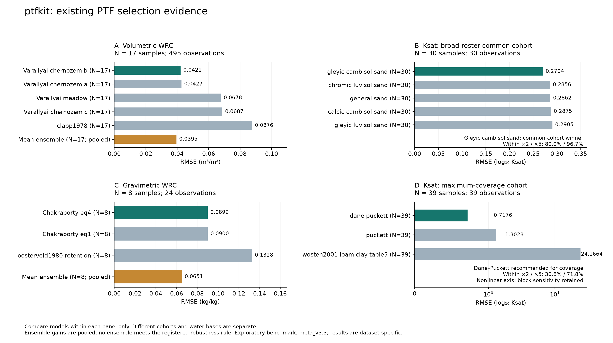
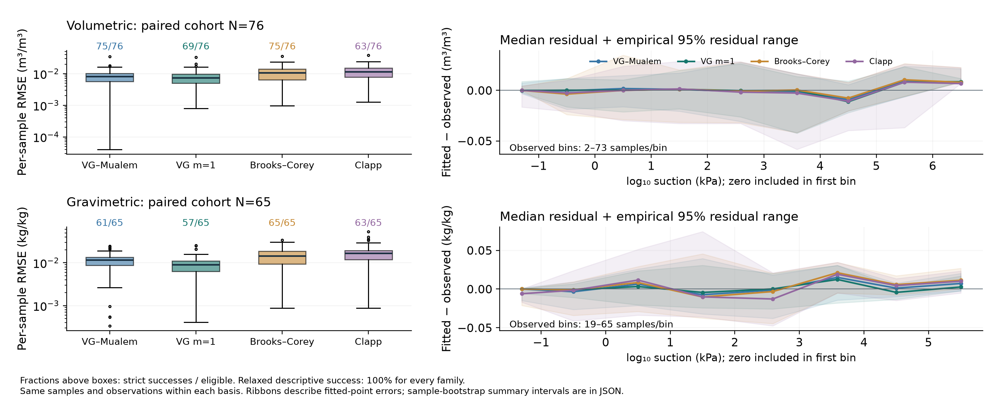

# ptfkit benchmark results

The existing PTF selection is retained. Four analytical families were independently fitted across the complete usable ledger; the presentation follows completed calculations and figures.

## Dataset and interpretation

The existing selection ledger contains 1,701 WRC points in 142 sample records (1,069 volumetric; 632 gravimetric), 19 source labels and one explicitly identified profile; 136 sample records lack profile IDs. Ksat contains 39 observations across three source labels and four source/unit blocks. These are workbook records, not independently verified laboratory measurements. The full WRC ledger is larger than the PTF-compatible cohorts below.

WRC RMSE is sqrt(mean across samples of within-sample mean squared error); MAE and bias also weight samples equally. Bias is prediction minus observation. Ksat errors are log10(prediction/observation). Cohort-specific errors must not be ranked across different rows or water bases. Reported pressure limits describe observed support, not confidence intervals or uniformly validated interpolation domains.

## PTF selection

| Target / cohort | Selected function | RMSE | MAE | Bias | Samples / points | Pressure (kPa) |
|---|---|---:|---:|---:|---:|---|
| Volumetric, m³/m³ | `calc_ptf_varallyai1982_chernozem_b` | 0.042122 | 0.033970 | +0.011225 | 17 / 495 | 0.060473–257941 |
| Gravimetric, kg/kg | `calc_ptf_chakraborty2011_eq4` | 0.089888 | 0.075289 | +0.044119 | 8 / 24 | 93.765–585.613 |
| Ksat common cohort, log10 | `calc_ptf_ferrerjulia2004_gleyic_cambisol_sand` | 0.270425 | 0.205407 | +0.061968 | 30 / 30 | — |
| Ksat maximum coverage, log10 | `calc_ptf_ferrerjulia2004_dane_puckett` | 0.717641 | 0.594349 | -0.168015 | 39 / 39 | — |

Varallyai chernozem A is close to B on the same 17-sample cohort (RMSE 0.042692 versus 0.042122); meadow, chernozem C and Clapp yield 0.067764, 0.068704 and 0.087605. B ranks second in both source-omission rankings, so its pooled win is not evidence of dominance under source shift. The wider three-model common cohort also favors B (30 samples, 608 points, RMSE 0.045390); this is a separate comparison.

Chakraborty eq4 has only eight samples and one source on the primary gravimetric cohort. Eq1 is essentially tied (0.090029 versus 0.089888); eq4 ranks first in 54.4% of sample bootstrap draws. This supports a tentative dataset-specific candidate, not a strong distinction between the equations.

### Ensembles

| Basis | Best atomic RMSE | Mean pooled RMSE | Relative change | Held-out evidence |
|---|---:|---:|---:|---|
| Volumetric | 0.042122 | 0.039503 | -6.22% | Mean beats pooled-best atomic in 1/2 source folds; nested reduced RMSE 0.063124 |
| Gravimetric | 0.089888 | 0.065109 | -27.57% | Mean beats pooled-best atomic in 84.4% of 499 evaluable out-of-bag draws; one source only |

The registered robustness rule requires at least 1% pooled improvement and lower error in every held-out evaluation against both the training-selected and pooled-best atomic comparators. No ensemble passes. In the two volumetric source folds, mean ensemble RMSE is 0.042417 / 0.033509 versus pooled-best atomic 0.041308 / 0.043576. The reduced ensemble reselects members inside training folds; its held-out RMSE 0.063124 must not be confused with its full-data RMSE 0.040081. Gravimetric out-of-bag evidence is within-source, not external source validation.

### Ksat coverage and block sensitivity

Gleyic cambisol sand reaches factors ×2/×5/×10 on 80.0%/96.7%/100.0% of the 30-sample common cohort. Dane–Puckett reaches 30.8%/71.8%/79.5% on the separate 39-sample maximum-coverage cohort. The latter is the coverage recommendation, with substantial block sensitivity; it is not a universally block-stable winner. No Ksat ensemble is constructed.

| Block | N | Dane–Puckett RMSE(log10) | Bias(log10) | Within ×2 / ×5 |
|---|---:|---:|---:|---:|
| master_cm_day | 3 | 0.537337 | +0.532287 | 0.0% / 100.0% |
| thesis_cm_day | 1 | 0.344314 | -0.344314 | 0.0% / 100.0% |
| thesis_cm_min_assumed | 30 | 0.660217 | -0.434413 | 40.0% / 76.7% |
| thesis_m_day | 5 | 1.097635 | +1.045454 | 0.0% / 20.0% |

Dane–Puckett wins the remaining-data ranking after three of four block omissions. Omitting the 30-sample cm/min-assumed block changes the winner to Wosten Table 5 (nine remaining samples). This omission sensitivity is different from independent prediction on the omitted block. Full remaining and held-out rankings are retained in the JSON. The literal unit `cm/smin` was interpreted as cm/min; methods and measurement origins remain unconfirmed. Class-specific Ferrer-Julia regressions are E5 applicability extrapolations: FAO classes are not established by this workbook.

## Analytical approximation of experimental WRC

**Preferred overall descriptive family: van Genuchten with m=1, separately for both water bases.** This is fitted-curve approximation, not independent PTF prediction. Of 142 samples, 141 have enough distinct pressures: 76 volumetric and 65 gravimetric. One volumetric curve has too few points. All four families converge to nondegenerate descriptive fits on these same samples (564 eligible fits).

| Basis | Family | Strict / eligible | Relaxed / eligible | Median RMSE | Median MAE | Median ΔAICc | Median ΔBIC |
|---|---|---:|---:|---:|---:|---:|---:|
| Volume (m³/m³) | VG–Mualem | 75/76 | 76/76 | 0.008226 | 0.006779 | 6.019 | 2.429 |
| Volume (m³/m³) | VG m=1 | 69/76 | 76/76 | 0.007472 | 0.006102 | 1.161 | 0 |
| Volume (m³/m³) | Brooks–Corey | 75/76 | 76/76 | 0.010739 | 0.008741 | 12.71 | 3.236 |
| Volume (m³/m³) | Clapp | 63/76 | 76/76 | 0.011478 | 0.009293 | 0.9298 | 2.919 |
| Mass (kg/kg) | VG–Mualem | 61/65 | 65/65 | 0.011576 | 0.008915 | 9.672 | 2.81 |
| Mass (kg/kg) | VG m=1 | 57/65 | 65/65 | 0.009073 | 0.007116 | 0 | 0 |
| Mass (kg/kg) | Brooks–Corey | 65/65 | 65/65 | 0.014410 | 0.011688 | 15.42 | 9.376 |
| Mass (kg/kg) | Clapp | 63/65 | 65/65 | 0.016585 | 0.013586 | 7.63 | 9.906 |

RMSE/MAE medians use the identical relaxed-success sample/point cohorts within each basis. Strict acceptance is a sensitivity analysis, not a filter silently applied to the plotted distributions. VG m=1 also leads median RMSE on the strict common cohorts. ΔAICc/ΔBIC are differences from the best family on each sample; their medians do not identify the same criterion as median RMSE. In particular, the simpler Clapp model is competitive under volumetric AICc.

The sample-bootstrap median paired RMSE difference (VG m=1 minus VG–Mualem) is:

- Volume: -0.000440, bootstrap 95% [-0.001065, -0.000010] (N=76).
- Mass: -0.001021, bootstrap 95% [-0.002139, -0.000210] (N=65).

These are exploratory within-dataset, sample-level resamples. Source/profile dependence is not resolved, and the near-zero volumetric upper limit supports a modest advantage rather than universal superiority.

### Acceptance and parameter diagnostics

Each curve uses deterministic bounded multistart least squares in the original water unit, with ordered residual/saturated water coordinates. Brooks–Corey receives additional starts in every observed-pressure partition. Strict acceptance requires optimizer convergence, finite physical predictions, n>p, no critical imposed-bound hit, nonconstant fitted values, full column-normalized Jacobian rank and condition ≤10¹⁰. A residual-water value of zero is allowed as a physical nested model; it is still recorded as a boundary hit. Relaxed success retains boundary/conditioning flags and is used only to describe the achievable curve fit. Bounds and all rejection counts are explicit in JSON.

Volumetric amplitudes are bounded by 1 m³/m³. Gravimetric amplitudes use the same registered shapes with an explicit homogeneous amplitude rescaling and a numerical upper box of 5 kg/kg; this is not a physical universal maximum. No density conversion or water-basis relabeling is used. The Clapp constraint 0<b<11.5 is preserved. The four registered families are the complete comparison roster.

AICc/BIC count p curve parameters plus estimated residual variance (K=p+1). AICc is undefined for n≤K+1; common AICc coverage is 52 volume and 42 mass samples. Information criteria are descriptive Gaussian approximations; iid residual regularity and boundary assumptions have not been validated. R² is stored descriptively and never determines acceptance. Conditional local-linear parameter intervals are retained for suitable strict, interior fits; they are not prediction intervals, and intervals crossing physical bounds are flagged.

Typical strict interior VG m=1 fits (closest to the strict median RMSE among fits with intervals) are retained as private [volumetric](../../../../local/meta-final-benchmark/parameter-uncertainty-example-volumetric_water_content-van_genuchten_m1_v1.json) and [gravimetric](../../../../local/meta-final-benchmark/parameter-uncertainty-example-gravimetric_water_content-van_genuchten_m1_v1.json) examples, with parameters, units and conditional 95% intervals.

### Pressure support, error and practical use

| Basis | VG m=1 strict support min–max (kPa) | Central 5–95% support (kPa) | Strict samples |
|---|---:|---:|---:|
| Volume | 0–9.80665e+06 | 0.10035–77897 | 69 |
| Mass | 0–310114 | 0.24633–158085 | 57 |

These are observed/support ranges with equal sample weighting for percentiles. They neither establish uniform performance throughout the interval nor authorize extrapolation. The very large dry-end pressures are retained workbook values and require source/protocol caution.

| Basis / region (kPa) | Lowest numerical MAE family | Samples / points | Median AE | 95th percentile AE | Bias | Pairwise superiority established? |
|---|---|---:|---:|---:|---:|---|
| Volume, wet [0,10) | VG–Mualem | 76 / 544 | 0.00283 | 0.01511 | -0.00019 | No clear separation from all alternatives |
| Volume, intermediate [10,1500) | VG m=1 | 73 / 398 | 0.00489 | 0.02179 | +0.00114 | No clear separation from all alternatives |
| Volume, dry [1500,∞) | VG–Mualem | 43 / 125 | 0.00614 | 0.02139 | -0.00079 | No clear separation from all alternatives |
| Mass, wet [0,10) | VG m=1 | 65 / 216 | 0.00516 | 0.02044 | +0.00111 | All three exploratory paired intervals below zero |
| Mass, intermediate [10,1500) | VG m=1 | 65 / 223 | 0.00686 | 0.02434 | -0.00293 | All three exploratory paired intervals below zero |
| Mass, dry [1500,∞) | VG m=1 | 37 / 193 | 0.00477 | 0.01483 | +0.00135 | All three exploratory paired intervals below zero |

Regional winners minimize equal-sample mean absolute error; median AE and tail errors describe the same cohort. Numerical regional differences alone do not justify model switching. Detailed results for every family/region and the paired bootstrap differences are in JSON. For VG m=1, volume errors are smallest in the wet region (<10 kPa; N=76, median AE 0.00344, 95th-percentile AE 0.01164 m³/m³). Mass errors are smallest in the observed dry region (≥1500 kPa; N=37, median AE 0.00477, 95th-percentile AE 0.01483 kg/kg). The per-family lowest observed MAE region and its N/tail error are recorded in CSV; regional support differs, so these are descriptive reliability patterns. Read practical trust from support, sample counts and regional errors together; no arbitrary absolute-error threshold or single confidence range is imposed.

The pressure ribbons are equal-sample empirical 2.5–97.5% fitted-point residual quantiles. Separately, 1,000 whole-sample bootstrap draws per bin provide 95% intervals for the median residual, bias, MAE and RMSE. All points of a selected sample stay together. These fitted-point residuals do not validate future-sample predictive coverage. The first pressure bin includes zero; it is displayed at a finite log coordinate. Parameter intervals, bootstrap uncertainty of summaries and observed pressure support are distinct quantities.

## Deliverables and reproducibility

- `ptf_selection_summary.csv`: 60 existing selection/ensemble rows, with explicit cohorts and units.
- `wrc_approximation_summary.csv`: eight family/basis rows, success, paired errors, information criteria, boundary diagnostics and strict/relaxed support.
- `benchmark_aggregates.json`: full original selection aggregates, new approximation aggregates, pressure bins, paired comparisons, policies and provenance.
- `figures/`: standalone PNG/SVG Figure 1, Figure 2 and a larger-label Figure 1 variant for slides.
- `ptfkit_benchmark_summary.pptx`: two main slides and one methods/support appendix.
- Private `local/meta-final-benchmark/`: observation ledger, exclusions, all 568 sample/family decisions, parameters, point residuals and conditional parameter intervals. Original data are not committed.

The workbook SHA-256 matches the pinned mapping and previous selection. Reconstructed observation counts, sample counts, basis totals and pressure extrema match the prior ledger; 92 stored fitted workbook parameters remain excluded from observations. Workbook-origin and E5 applicability limitations remain unchanged. No new PTF was unlocked or recalibrated, and Part A was not rerun.

Reproduce with the source Python packages on `PYTHONPATH` (`targets/ptfkit-eval/src`, `targets/ptfkit-py/src` and the repository root): `python -m evaluation.experiments.meta_v3_3.final_approximation`; then `python -m evaluation.experiments.meta_v3_3.publish_final_results`. The rendering command only runs after the aggregate calculations exist. Exact runtime versions and reproduction source hashes are in JSON.

Exploratory benchmark, meta_v3.3; results are dataset-specific.
